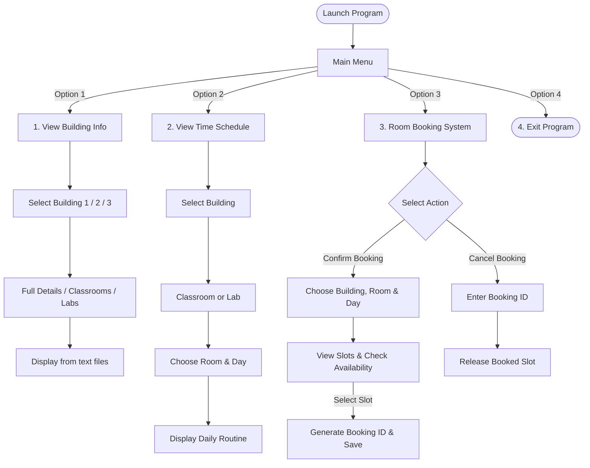

# 🏫 University Room Management System

<div align="center">


<p align="center">
  A lightweight, robust, and console-based University Room Management and Booking System developed in <b>C++</b>. Designed to streamline campus building information tracking, classroom and laboratory scheduling, and conflict-free room reservations using a structured file-based storage architecture.
</p>

[Key Features](#-key-features) •
[System Architecture](#-system-architecture) •
[Directory Structure](#-directory-structure) •
[Getting Started](#-getting-started) •
[User Guide](#-user-guide) •
[Future Roadmap](#-future-roadmap) •
[Author](#-author)

</div>

---

## 📌 Key Features

- 🏢 **Multi-Building Explorer**: Comprehensive overview of buildings across campus (Building 1, 2, and 3), including capacity and layout information.
- 🏫 **Classroom & Lab Categorization**: View categorized directories of general lecture rooms and specialized technical laboratories.
- 🗓️ **Weekly Routine & Timetable Viewer**: Check class schedules across all 7 days (Sunday through Saturday) broken down by time slots.
- ✍️ **Dynamic Room Reservation Engine**: Real-time availability indicator (`Available`, `Not Available`, `Booked`). Automatically generates unique Booking Confirmation IDs (e.g. `203Sun4`).
- ❌ **Booking Cancellation**: Instantly cancel reservations by entering the designated Booking ID and free up slots in real-time.
- 📁 **Zero-Dependency Flat File Storage**: Uses formatted `.txt` files for fast data retrieval, zero external database setup, and high portability.

---

## 🏗️ System Architecture



---

## 📂 Directory Structure

```text
University_Room_Management_System/
├── Buildingsinfo/                    # Building summary and infrastructure data files
│   ├── building1.txt
│   ├── building2.txt
│   └── building3.txt
├── Classroomsinfo/                   # Classroom directories by building
│   ├── classroomsB1.txt
│   ├── classroomsB2.txt
│   └── classroomsB3.txt
├── Labroomsinfo/                     # Specialized computer & science lab directories
│   ├── labroomsB1.txt
│   ├── labroomsB2.txt
│   └── labroomsB3.txt
├── RoomSchedules/                    # Detailed weekly timetable schedules per room
│   ├── 202B2schedule.txt
│   ├── 203B1schedule.txt
│   └── ...
├── modules/                          # Standalone modular components
│   ├── Building_rooms_time_scedule.cpp
│   ├── Full_Building_show.cpp
│   └── Room_Booking_System.cpp
├── tests/                            # Development tests and draft prototypes
│   ├── TestProjectCode.cpp
│   ├── test01A.txt
│   ├── test02.cpp
│   ├── test_File_Run.cpp
│   └── testroombooked.cpp
├── .gitignore                        # Git ignore rules for binaries and temporary files
├── LICENSE                           # MIT License
├── Makefile                          # Build automation script
├── Main.cpp                          # Application Entry Point
└── README.md                         # Project documentation
```

---

## 🛠️ Getting Started

### 📋 Prerequisites

To compile and run this application, you only need a modern C++ compiler supporting **C++11** or higher:
- **Windows**: [MinGW-w64](https://www.mingw-w64.org/) / MSVC / Clang
- **Linux**: `g++` (GCC) or `clang++`
- **macOS**: Clang / Apple Developer Tools (`xcode-select --install`)

---

### 💻 Installation & Compilation

#### 1. Clone the Repository
```bash
git clone https://github.com/fahim-islam-20255103072/University_Room_Management_System.git
cd University_Room_Management_System
```

#### 2. Compile

**Using `g++` (Recommended):**
```bash
g++ -std=c++11 Main.cpp -o main
```

**Using `Makefile` (Linux / macOS / MinGW):**
```bash
make
```

#### 3. Run

**On Windows:**
```cmd
main.exe
```

**On Linux / macOS:**
```bash
./main
```

> ⚠️ **Important:** Always execute the executable from the project root directory so the relative paths to `Buildingsinfo/`, `Classroomsinfo/`, `Labroomsinfo/`, and `RoomSchedules/` resolve properly.

---

## 🧭 User Guide

Upon launching the application, you are greeted with the primary menu:

```text
============================================================
           ~ Welcome to our Room Management Program ~ 
============================================================
              ========== Room Management Menu ========== 

             1) View Info
             2) View Time Schedule
             3) Room Booked System
             4) Exit

             Enter your choice : 
```

### 1️⃣ Option 1: View Info
* Select a building (Building 1, 2, or 3).
* View complete infrastructure details, classrooms list, or dedicated laboratories.

### 2️⃣ Option 2: View Time Schedule
* Select the building and room type.
* Pick a specific room number (e.g. `203`, `302`, `502`).
* Enter the day of the week (e.g. `Sunday`, `Monday`, `Tuesday`, etc.).
* Inspect class times and scheduled lecture names.

### 3️⃣ Option 3: Room Booking System
* **Confirm Booking:**
  * Displays timeslot list with dynamic status indicators (`Available` vs `Not Available` vs `Booked`).
  * Choose an available slot number to reserve the room.
  * Receive your unique Booking ID (Format: `<RoomNumber><DayPrefix><SlotNumber>`, e.g., `203Sun4`).
* **Cancel Booking:**
  * Enter your generated Booking ID to release the reservation.

---

## 🚀 Future Roadmap

- [ ] **User Role Authentication**: Separate interfaces for Students, Faculty, and Admin.
- [ ] **Automated Conflict Detection**: Prevent overlapping bookings across consecutive slots.
- [ ] **Advanced Filtering**: Filter rooms by capacity, projector availability, and AC facilities.
- [ ] **Persistent Database Support**: Migration option to SQLite / MySQL.
- [ ] **GUI / Web Dashboard**: Modern graphical user interface built with Qt or web technologies.

---

## 👨‍💻 Author

**Fahim Islam**
- GitHub: [@fahim-islam-20255103072](https://github.com/fahim-islam-20255103072)

---

## 📄 License

This project is licensed under the **MIT License** — see the [LICENSE](LICENSE) file for details.
